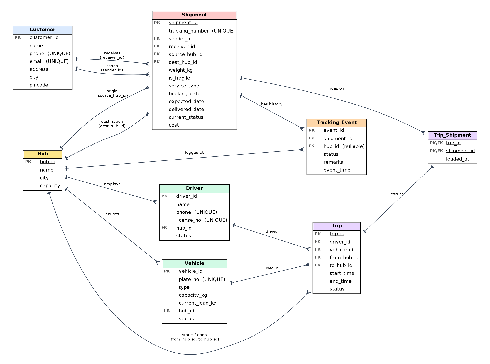

# ⚡ Swift Data: Delivery Logistics Database Management System

A production-grade DBMS project built on **MySQL 8.0** with a modern **Python Flask** web portal.



---

## 📌 Project Architecture

- **Database Engine**: MySQL 8.0 (InnoDB engine with full ACID compliance)
- **Front End**: Python Flask with Vanilla CSS (Dark Slate Theme, Glassmorphism, Micro-Interactions)
- **Tables (8)**: `Customer`, `Hub`, `Driver`, `Vehicle`, `Shipment`, `Trip`, `Trip_Shipment`, `Tracking_Event`
- **Relationships**: 14 Foreign Keys (13 One-to-Many, 1 Many-to-Many resolved by junction table)
- **Constraints**: 7 CHECK constraints, UNIQUE, NOT NULL, DEFAULT, ENUM
- **Advanced Logic**:
  - `v_live_shipment_status` (View with correlated subquery)
  - `trg_event_updates_shipment` (Trigger automatically synchronizing shipment status)
  - `sp_assign_shipment_to_trip` (Stored Procedure with ACID transaction & rollback)
- **Analytical Queries**: 7 SQL business intelligence reports

---

## 📁 Repository Structure

```text
dbms_project/
├── app.py                      # Flask web application routes & query endpoints
├── config.py                   # Database configuration loader (supports .env)
├── setup_db.py                 # Automated MySQL database initializer
├── requirements.txt            # Python dependencies
├── .env.example                # Sample database environment variables
├── .gitignore                  # Git ignore rules
│
├── sql/                        # Complete MySQL scripts
│   ├── swift_data_schema.sql   # DDL: 8 tables, 14 foreign keys, 7 checks, 3 indexes
│   ├── swift_data_sample.sql   # DML: Realistic dataset (5 hubs, 12 customers, 15 shipments...)
│   ├── swift_data_advanced.sql # View, trigger, stored procedure with transaction & demo
│   └── swift_data_queries.sql  # 7 analytical DBMS queries with business logic
│
├── templates/                  # Frontend Jinja templates
│   ├── layout.html             # Base navigation & alert toasts
│   ├── track.html              # Parcel search & live milestone timeline
│   ├── new_shipment.html       # Booking portal with dynamic price estimator
│   ├── assign.html             # Trip dispatch & cargo loading (Stored Procedure)
│   ├── new_event.html          # Milestone logger (fires database trigger)
│   ├── reports.html            # 6 analytical management reports
│   ├── add_records.html        # Registry forms for Customers, Drivers, Vehicles, Hubs
│   └── error.html              # Database error & troubleshooting assistant
│
├── static/
│   └── style.css               # Modern dark-mode UI stylesheet
│
└── docs/
    ├── DATABASE_DESIGN.md      # Full relational schema, ER diagram & normalization
    ├── er_diagram.png          # Visual entity-relationship diagram
    └── Swift_Data_Viva_Guide.docx # Comprehensive viva preparation guide
```

---

## 🚀 Quick Setup & Run (Windows)

### 1. Install Python Dependencies
```powershell
pip install -r requirements.txt
```

### 2. Configure Your MySQL Database
Copy `.env.example` to `.env` and set your MySQL root password:
```ini
DB_HOST=127.0.0.1
DB_PORT=3306
DB_USER=root
DB_PASSWORD=your_mysql_password
DB_NAME=swift_data
```
*(Or set the environment variable directly: `$env:DB_PASSWORD="your_mysql_password"`)*

### 3. Initialize the Database
Run the setup utility to execute the schema, sample data, view, trigger, and stored procedure:
```powershell
python setup_db.py
```
*(Alternatively, execute the 4 SQL files in `sql/` sequentially in MySQL Workbench.)*

### 4. Start the Application
```powershell
python app.py
```

Open your browser at: **[http://127.0.0.1:5000](http://127.0.0.1:5000)**

---

## 🖥️ Web Portal Features

| Page | Route | DBMS Concepts Demonstrated |
|---|---|---|
| **Track** | `/` | Multi-table joins, reverse-chronological timeline, status metrics |
| **Book Parcel** | `/shipments/new` | Transactional INSERT, CHECK constraint validation, auto-generated TRK IDs |
| **Load Trips** | `/assign` | Stored Procedure `sp_assign_shipment_to_trip`, ACID transaction rollback on overload, M:N junction |
| **Log Event** | `/events/new` | Database trigger `trg_event_updates_shipment` auto-syncs status and delivery timestamp |
| **Reports** | `/reports` | Conditional `SUM()`, `GROUP BY`, `HAVING`, vehicle load ratio calculation |
| **Master Registry** | `/add` | Master entity management with input validation and uniqueness constraints |

---

## 🎓 Viva Preparation & Reference

Refer to the included [Viva Guide](docs/Swift_Data_Viva_Guide.docx) and [Database Design Doc](docs/DATABASE_DESIGN.md) for full explanations of:
- 1NF, 2NF, and 3NF normalization justifications
- ACID properties in `sp_assign_shipment_to_trip`
- Referential integrity actions (`ON DELETE RESTRICT / CASCADE / SET NULL`)
- Analytical SQL query rationale
