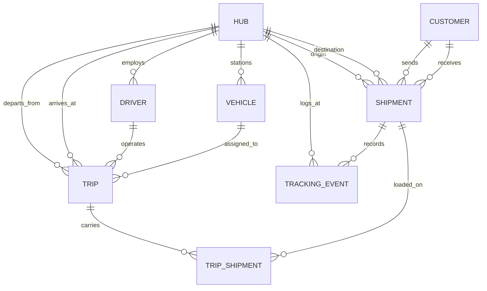

# Swift Data Logistics — Database Architecture & DBMS Documentation

## 1. Project Overview
- **System**: Swift Data Delivery Logistics Database Management System
- **Engine**: MySQL 8.0 (InnoDB Engine with ACID Compliance)
- **Front End**: Python Flask Web Portal
- **Entities**: 8 Normalized Relational Tables
- **Foreign Keys**: 14 Referential Integrity Constraints
- **CHECK Constraints**: 7 Domain Validation Rules
- **Advanced Features**: 1 View, 1 Trigger, 1 Stored Procedure with Transaction & Rollback, 3 Explicit Indexes

---

## 2. Entity-Relationship (ER) Diagram

---

## 3. Relational Schema Summary

| Table | Type | Purpose | Primary Key | Foreign Keys |
|---|---|---|---|---|
| `Hub` | Master | City transit and sorting hubs | `hub_id` | — |
| `Customer` | Master | Senders and receivers | `customer_id` | — |
| `Driver` | Master | Logistics staff with assigned home hub | `driver_id` | `hub_id` ➔ `Hub` |
| `Vehicle` | Master | Fleet (Bikes, Vans, Trucks) with load tracking | `vehicle_id` | `hub_id` ➔ `Hub` |
| `Shipment` | Transaction | Core delivery manifest | `shipment_id` | `sender_id`, `receiver_id` ➔ `Customer` `source_hub_id`, `dest_hub_id` ➔ `Hub` |
| `Trip` | Transaction | Inter-hub route runs | `trip_id` | `driver_id` ➔ `Driver` `vehicle_id` ➔ `Vehicle` `from_hub_id`, `to_hub_id` ➔ `Hub` |
| `Trip_Shipment` | Junction | Resolves M:N between Trips and Shipments | `(trip_id, shipment_id)` | `trip_id` ➔ `Trip` `shipment_id` ➔ `Shipment` |
| `Tracking_Event` | History | Immutable milestone tracking diary | `event_id` | `shipment_id` ➔ `Shipment` `hub_id` ➔ `Hub` |

---

## 4. Normalization Analysis

- **1NF**: Atomic attributes; no repeating groups. Multi-step movement is decomposed into `Tracking_Event` rows and `Trip_Shipment` links.
- **2NF**: No partial functional dependencies. Only `Trip_Shipment` uses a composite primary key `(trip_id, shipment_id)`, and `loaded_at` functionally depends on both components.
- **3NF**: Every non-key attribute depends strictly on the primary key without transitive dependencies. Hub city and name are fetched via joins rather than stored in shipments.
- **Deliberate Denormalization**: 
  - `Shipment.current_status` and `Shipment.delivered_date` for instantaneous tracking lookups. Automatically kept in sync by trigger `trg_event_updates_shipment`.
  - `Vehicle.current_load_kg` for fast capacity checks. Synchronized atomically inside stored procedure `sp_assign_shipment_to_trip`.

---

## 5. Advanced DBMS Logic

### 5.1 View: `v_live_shipment_status`
Encapsulates 5-table joins and a correlated subquery fetching the latest tracking event status, timestamp, and hub name for every parcel.

### 5.2 Trigger: `trg_event_updates_shipment`
Fires `AFTER INSERT ON Tracking_Event FOR EACH ROW`. Automatically propagates milestone updates into `Shipment.current_status` and records `delivered_date = event_time` upon delivery.

### 5.3 Stored Procedure: `sp_assign_shipment_to_trip`
Executes an ACID transaction loading a parcel onto a trip:
1. `START TRANSACTION`
2. Locks Trip, Shipment, and Vehicle rows with `FOR UPDATE`.
3. Verifies `current_load + parcel_weight <= capacity`. On overload, signals SQLSTATE `45000` (`'Vehicle capacity exceeded'`).
4. Inserts into `Trip_Shipment`.
5. Updates `Vehicle.current_load_kg`.
6. Inserts milestone `Tracking_Event('Departed Hub')`.
7. `COMMIT`. If any step fails, `DECLARE EXIT HANDLER FOR SQLEXCEPTION` triggers `ROLLBACK`.

---

## 6. The 7 Analytical SQL Queries

1. **Q1 Tracking History**: Full milestone history with `INNER JOIN` and `LEFT JOIN` on Hub.
2. **Q2 Driver Performance**: 4-table join calculating trip volume and delivered parcels per driver.
3. **Q3 Delay Analytics**: Destination hub delay rate using `SUM(DATE(delivered_date) > expected_date)`.
4. **Q4 Fleet Utilization**: Mathematical ratio of `current_load_kg / capacity_kg`.
5. **Q5 Revenue Breakdown**: Aggregations by service tier (Standard vs Express) and origin hub city.
6. **Q6 Delivery Exceptions**: Customer senders with highest failed delivery rates.
7. **Q7 Multi-Leg Shipments**: `HAVING COUNT(ts.trip_id) > 1` proving many-to-many trip relationships.
